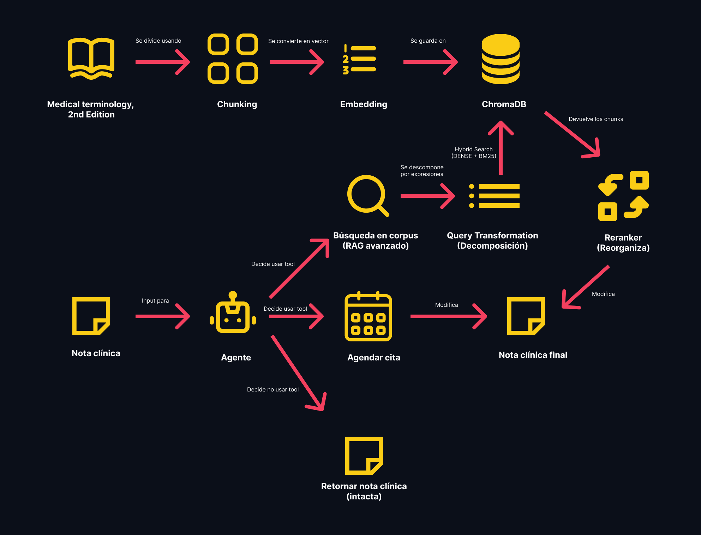

Tópicos Especiales y Aplicaciones en Inteligencia Artificial — SI4006 
# Entrega M2 - RAG
## Esteban Álvarez Zuluaga, Mateo Pineda Álvarez

Sistema que toma la conversación entre un médico y su paciente y genera un borrador de la historia clínica, para ahorrarle tiempo de documentación al personal de salud. Esto se logra en parte con la ayuda de documentos con terminología médica que permite darle a los borradores un tono más profesional y con términos precisos.

## Contenido

## Disclaimer
Este es un trabajo netamente académico, sin fines comerciales ni de otra índole. El uso del material de este trabajo es bajo este propósito, siguiendo las normas de las licencias del material utilizado y la legislación colombiana.

## Mejoras al Harness de M2

El harness de M2 no era efectivo para medir qué tan buena era una respuesta. En muchos casos daba el mismo puntaje a respuestas correctas e incorrectas, y en ocasiones no detectaba ejemplos claramente correctos o incorrectos. Al iterar la rúbrica, en general se lograba cambiar la severidad del juez, pero entonces tendía a calificar todo alto o todo muy bajo. El harness inicial consistía en un solo prompt de puntaje 1 a 5 sobre Qwen2.5-1.5B. Para solucionar este problema se intentaron varias estrategias, y finalmente se logró un juez razonable que concuerda con el criterio humano en el eval set.

Inicialmente se particionó la tarea de juzgar la nota clínica entre tres jueces distintos (todos Qwen2.5-1.5B) (Qwen Team, 2024), cada uno a cargo de una dimensión: grounding (que todo lo que diga la nota esté apoyado por el diálogo, sin inventar ni tergiversar información), coverage (que la nota incluya todo lo clínicamente relevante que se dijo en el diálogo) y form (que tenga la estructura de una historia clínica y no la de un diálogo o lenguaje informal). El puntaje final es el promedio ponderado de los tres (0.45, 0.35 y 0.20), limitado a 2 cuando grounding es 2 o menos, para que un error factual no se compense con buena forma.

Esto no solucionó el problema, ya que el modelo seguía dando resultados erróneos, pero sí permitió evidenciar su incapacidad para juzgar adecuadamente. Con los tres jueces, el puntaje final fue 4.37 para el baseline y 4.42 para el fine-tuned, aunque ROUGE-1 subía de 0.29 a 0.44; 38 de los 60 puntajes fueron 5 y ninguno fue 1. En forma, por ejemplo, 5 de las 6 notas que empezaban con “Patient:” o “Doctor:” recibieron 5, aunque se le instruía explícitamente poner 1 a un diálogo. Por esto se implementaron mecanismos para mejorar la trazabilidad de las respuestas. Primero, se definió con pydantic una salida estructurada obligatoria con explicación y puntaje. Luego se creó un conjunto de pruebas triviales (prueba de sanidad) para evaluar la capacidad de distinguir al menos los casos obvios. Para cada ejemplo del eval set se generan cuatro notas de control con un puntaje esperado conocido: la nota de referencia, el diálogo copiado tal cual, la referencia con una oración inventada inyectada y la referencia recortada a su primera oración. Así se mide si cada juez detecta el error de su área y si no se inmiscuye en las áreas de los otros jueces.

Se intentaron numerosos cambios a las rúbricas de los tres jueces, con prompting negativo y rúbricas por resta de puntos, pero ninguno fue satisfactorio. Luego se cambió el modelo a Qwen2.5-3B y se evaluaron tres versiones de las rúbricas con la prueba de sanidad. En la mejor, grounding aprobó 9 de 10 notas correctas y detectó 10 de 10 datos inventados, y coverage detectó 6 de 7 notas recortadas; en el harness, el puntaje final fue 2.89 para el baseline y 3.60 para el fine-tuned. Este era el mejor resultado hasta ese momento, y aunque todavía se evidenciaban errores, ya existía diferenciación entre una respuesta buena y una mala. Aun así, seguía fallando en casos triviales que no pudieron resolverse con cambios en el prompt:

El juez de forma detectó como máximo 5 de 10 diálogos copiados (0 de 10 en la primera versión).
Grounding penalizó 3 de 7 notas recortadas por omitir información, aunque la rúbrica lo prohibía.
Coverage aprobó solo 3 de 10 notas correctas.
En las versiones con ejemplo, 12 a 13 de 57 explicaciones listaban como faltantes datos del ejemplo de la rúbrica (“aspirin”, “headache”).

Finalmente, se cambió el modelo a Flow-Judge-v0.1 (3.8B) (Flow AI, 2024), basado en la arquitectura de Phi-3.5-mini (Abdin et al., 2024), con licencia Apache 2.0 y con fine-tuning específico para evaluar salidas a partir de un criterio y una rúbrica. Se reescribieron las rúbricas en el formato estándar del modelo (un criterio y una descripción para cada puntaje del 1 al 5, con salida en etiquetas <feedback> y <score>), y la mejora fue considerable. En la prueba de sanidad:

Grounding aprobó 10 de 10 notas correctas, no penalizó ninguna de las 7 notas recortadas y detectó 8 de 10 datos inventados.
Form detectó 9 de 10 diálogos copiados y aprobó 9 de 10 notas correctas.
Coverage aprobó 7 de 10 notas correctas y detectó 6 de 7 notas recortadas.

En el harness se evidenció una marcada diferencia entre el baseline y el fine-tuned: puntaje final 2.56 frente a 3.42, grounding 3.20 frente a 4.00 y form 1.40 frente a 3.90. Ninguna de las 171 respuestas del juez tuvo formato inválido. También se realizó una evaluación manual de los casos del eval set, y los puntajes concuerdan en gran medida con la opinión humana. El juez de forma fue el más consistente, con errores puntuales (por ejemplo, penalizar una lista de síntomas negados escrita con el mismo estilo de la referencia). Grounding y coverage presentaron en general resultados coherentes con su fin y explicaciones claras y concisas, que descomponen los motivos del puntaje, aunque en algunos casos penalizaban lo que le correspondía al otro: 8 de las 15 deducciones de grounding en el harness fueron por información faltante, y coverage penalizó las 10 notas con un dato inventado. Además, coverage no diferenció los sistemas (2.40 en ambos). Resta afinar las rúbricas para minimizar estas colisiones entre jueces, pero la mejora respecto a los resultados anteriores es notoria y ya se puede confiar en el juez como estimador de la bondad de una respuesta del modelo.

## Corpus e Índice
El corpus del dominio es el libro "Medical Terminology, 2nd edition" (Open Resources for Nursing (Open RN); Ernstmeyer K, Christman E, editors. Medical Terminology [Internet]. 2nd edition. Eau Claire (WI): Chippewa Valley Technical College; 2024. Available from: https://www.ncbi.nlm.nih.gov/books/NBK607454/?cmd=ClearHT). Este libro se encuentra bajo la licencia Creative Commons Attribution 4.0 International License, la cual permite compartir el material (copiar y redistribuir el material en cualquier medio o formato para cualquier propósito, incluso comercial) y adaptarlo (modificar, transformar y construir sobre el material para cualquier propósito, incluso comercial). Esta licencia tiene como requisito proveer reconocimiento a los autores del material (el material se encuentra citado en este mismo párrafo), proveer un enlace a la licencia (https://creativecommons.org/licenses/by/4.0/) e indicar si se le hicieron cambios al material (el material no fue modificado, solo fue usado como material de consulta para nuestro RAG).

El corpus se carga a nuestro pipeline y se hace una limpieza básica inicial, en la cual se eliminan números de página, guiones blandos (cuando una palabra queda dividida entre dos líneas), preservación de elementos como viñetas que sirven para los chunks y se ajustan algunos párrafos en los cuales hay salto de línea doble (como de cambio de párrafo) cuando realmente no hay un cambio de párrafo sino que debe ir un salto de línea único. Este corpus se guarda en una lista, donde cada elemento es un diccionario con id (número de página), fuente (el libro utilizado) y el texto de esa página. El libro usado contiene 994 páginas.

Posteriormente, se realiza el proceso de separar por chunks. Para este proceso revisamos las definiciones de los términos médicos presentes en el libro y detectamos unos patrones útiles:
1. Muchas definiciones estaban en viñetas dentro del capítulo o en viñetas al final de los capítulos en la sección de "Glosario".
2. Otras definiciones se encontraban dentro de los párrafos de los capítulos (sin viñeta) pero eran identificables porque después de cada término se pone entre paréntesis su pronunciación en inglés y finalizaba con dos puntos (para dar paso a la definición).
Estas dos características nos dieron patrones para usar expresiones regulares que encontraran las viñetas y estos textos de pronunciación para identificar las oraciones que contenían los términos con sus definiciones. Entonces cuando hay una viñeta, el chunk llega hasta donde se encuentre la próxima viñeta y hasta finalizar el párrafo (para cubrir el caso de que sea el último término del glosario). En el caso de los términos que se encuentran dentro de párrafos, se busca si hay más términos dentro del mismo párrafo y el chunk finaliza antes de ese próximo término; en caso contrario, el chunk va hasta el final del párrafo. Para el resto del corpus, los chunks se definieron por párrafos para que cada chunk englobara una idea completa y con sentido. Se fdeterminó que no se debía usar un overlap en los chunks porque esto haría que se combinen más de una definición bajo un solo chunk, lo cual confundiría al RAG a la hora de elegir el término adecuado. Con esta estrategia obtuvimos un total de 6086 chunks.

Continuando con el pipeline de indexación, debimos realizar embeddings de los chunks. Para esto usamos el modelo BAAI/bge-small-en-v1.5 en lugar del sentence-transformers/paraphrase-multilingual-MiniLM-L12-v2 usado en clase por dos razones principales:
1. Todo nuestro pipeline y modelos trabajan en el idioma inglés, entonces no necesitamos un modelo multilingüe.
2. BAAI/bge-small-en-v1.5 nos permite leer 512 tokens, a diferencia de los 128 tokens que lee el otro modelo. Esto nos permite hacer un embedding de chunks más grandes cuando tenemos párrafos extensos.

Estos embeddings fueron guardados en la base de datos vectorial ChromaDB, como fue recomendado en clase y en las instrucciones del ejercicio. Como tenemos una cantidfad considerable de chunks, el guardado en la BD fue por lotes para evitar un overflow de la memoria.

## RAG Ingenuo Como Línea de Base
Para el RAG ingenuo usamos Qwen2.5-1.5B-Instruct como modelo. Definimos que nuestro k sería de 10 (top-k traería 10 resultados) porque en un solo resumen médico puede haber más de un término que requiera reemplazo. El número 10 nos dio un buen balance entre traer un número adecuado de chunks para varios términos, sin traer muchos términos que no fueran pertinentes (definiciones que no sirvieran para la nota clínica evaluada).

La válvula de escape en nuestro caso era no hacer ninguna modificación al texto que le entra al RAG si ve que no hay un chunk que reemplace un término de este texto original o en caso de que el texto que recibiera no fuera una nota clínica. Esta válvula fue comprobada con dos ejemplos: "The cat lies on the couch" y "Roses are red, lemons are green". EN ambos casos devolvió estos textos sin cambios a pesar de traer chunks del libro. Tomamos la decisión de que el modelo no fuera verbal cuando se active la válvula de escape, es decir, no queremos que diga que no hizo ningún cambio porque el resultado final que queremos es la nota clínica (sea que le haga cambios o no) y no comentarios adicionales que nos haga el LLM.

## RAG Avanzado
Basándonos en los ejemplos que usamos en el RAG ingenuo, hicimos el diagnóstico de cuáles técnicas avanzadas de retrieval nos servirían para mejorar los chunks que nos llegan. Para esto, hay que tener en cuenta que el RAG ingenuo busca los chunks con una búsqueda semántica.

En el ejemplo de "The patient presents with high blood pressure and shortness of breath.", vemos que el RAG trae correctamente los dos términos correctos: hipertensión y disnea. Sin embargo, hipertensión es el chunk con la calificación más baja, incluso por debajo de hipotensión, que sería el término opuesto de lo que buscamos. Esto nos dio el argumento para implementar un reranker, el cual tomara estos chunks recuperados y los reorganizara y nos diera a las definiciones que realmente fueran las mejores candidatas para reemplazar los términos de la nota clínica. Al aplicar el reranker a este ejemplo, observamos que hipertensión logra subir al puesto número 6, lo cual es indicación de que esta técnica mejora el retrieval de los chunks pertinentes.

Volviendo al RAG ingenuo, con el ejemplo de "She reports edema of the lower extremities and syncope." no obtuvimos las definiciones que estábamos buscando. Para "swelling of the legs" queríamos el término de edema y para "fainting" buscamos el término de síncope. Como paréntesis, este ejemplo nos muestra que la válvula de escape funciona nuevamente porque, al no encontrar un chunk pertinente, el RAG deja el texto tal cual como le entra. Para resolvber entonces el problema de no obtener los chunks pertinentes, nos planteamos un hybrid search, de modo que el RAG ya no solo busque por semántica (DENSE) sino también por palabras (BM25); ambos resultados se combinan usando RRF y completando el hybrid search. Al ejecutar el hybrid search vemos que logramos recuperar uno de los chunks que necesitábamos: edema. SIn embargo, aún no recuperábamos el chunk de síncope. Esto puede deberse a que el modelo le esté dando más relevancia a "swelling of the legs" que representa un porcentaje alto de las palabras de la frase, lo que dejá relegado el "fainting" que también nos interesa.

Lo anterior nos llevó a la última técnica que incorporamos: query transformation usando descomposición. Con la descomposición logramos tomar la nota clínica y que un LLM encontrara cada uno de los términos médicos que deben ser buscados en el corpus. De esta forma, con la descomposición logramos obtener "swelling of the legs" y "fainting" que serán términos que se puedan buscar en el corpus y obtener chunks para cada uno de ellos de forma independiente.

Con estas tres técnicas avanzadas de retrieval construimos el RAG avanzado, en el cual ´primero se aplica la descomposición (para encontrar los términos que debemos buscar), seguido del hybrid search (para buscar por semántica y palabras exactas en el corpus) y finalizando con el reranker que ordena lo obtenido del hybrid search, de modo que los chunks más acordes a los términos buscados sean los que tengan el mayor puntaje. Para combinar las tres técnicas se tomaron nuevas decisiones. Lo primero, es que la descomposición formulaba preguntas de la forma "What is the medical term for ...?", lo cual puede generar ruido al buscar los chunks por usar palabras innecesarias (What, is, the, medical, term, for). Por lo tanto, decidimos tomar esta pregunta y extraer solo la expresión que se quiere traducir ("swelling of the legs" o "fainting"). De este modo, el hybrid search puede hacer un mejor trabajo buscando en el corpus. Adicionalmente, pensamos en el caso en donde una nota clínica tenga muchos términos que deban ser buscados; esto podría representar una tarea computacionalmente pesada, por lo cual restringimos la búsqueda a máximo 6 términos por nota clínica. Como cada uno de estos términos va a generar una búsqueda en el corpus, ya no necesitamos una k tan alta (la k inicial era de 10) porque no necesitamos recuperar varios conceptos sino solo uno; por este motivo, establecimos una k de 3 para el rag avanzado. Finalmente, se estableció un score mínimo del reranker; los chunks reordenados por el reranker deben tener un score superior a 0, porque es posible que los términos recuperados no sean un término correcto adecuado, bien sea porque se buscó un término que no requiere traducción o porque no se obtuvo una respuesta lo suficientemente buena del corpus. En este caso es preferible no modificar el término a realizar un cambio que no tenga sentido.

Finalmente, al probar el RAG avanzado con el ejemplo de "The patient presents with high blood pressure and shortness of breath." obtenemos correctamente el resultado esperado: "The patient presents with hypertension and dyspnea.". Para el otro ejemplo de "She complains of swelling of the legs and fainting." también obtenemos un resultado satisfactorio: "She complains of edema and syncope."

## RAGAS
Para el RAGAS usamos Qwen como evaluador. Queríamos usar el juez Flow, que en pruebas nos había dado resultados muy buenos y consistentes. Sin embargo, al integrarlo al notebook, al ser un modelo grande, este se consumía toda la GPU del notebook y no lograba finalizar la ejecución (lo cual va en contravía de las reglas de la entrega). Esto nos obligó a usar Qwen, un modelo más pequeño, aunque sacrificando la calidad de los resultados que es un trade-off claro al tomar este tipo de decisiones.

El RAGAS evalúa las siguientes métricas:

1. Context recall: evalúa si el contexto obtenido por el RAG contiene todo lo necesario para ejecutar la tarea (en nuestro caso, reemplazar términos médicos). Obtuvimos un resultado de 0 para el RAG ingenuo y de 0.1 para el RAG avanzado. Este context recall bajo nos indica que hay problemas de recuperación. En el RAG ingenuo era evidente desde los ejemplos y fue lo que nos llevó a usar las técnicas avanzadas de recuperación, como la descomposición y el hybrid search. Vemos que con el RAG avanzado mejora un poco, pero continúa siendo muy bajo. Esto puede explicarse por dos motivos: i) el retrieval va a depender mucho de la nota clínica analizada y esta nota clínica viene del modelo fine-tuneado que ya hemos visto que no realiza un muy buen trabajo. ii) A pesar de que la descomposición mejoró mucho la recuperación de muchos términos, a veces se puede confundir (y con mayor razón en notas clínicas de baja calidad) y puede buscar términos que realmente no deberían ser buscados (en testing que hicimos antes de la versión final, encontramos que a veces podía buscar cosas como "feeling very well", lo cual no va a tener una traducción en el corpus). Como estas expresiones no van a estar en el corpus, se obtienen chunks que no tienen nada que ver con lo que se está buscando y eso hace que etsa métrica baje.

2. Context precision: esta métrica representa que lo que se recupera del RAG es relevante y sin ruido. Es decir, de lo que se recupera, qué porcentaje es de verdad relevante. Vemos que esta métrica también fue baja, siendo de 0.36 en el RAG ingenuo y 0.37 en el RAG avanzado. Nuevamente vemos que el RAG avanzado mejora un poco esta métrica gracias al reranker, que se encarga de mejorar el orden del top-k trayendo al frente los chunks que son más relevantes para el caso específico. Nuevamente, dependemos de la calidad de las notas clínicas que nos da el modelo fine-tuneado, porque si la nota es de mala calidad, se van a buscar expresiones que no son relevantes para el significado clínico general de esa nota. Con el RAG avanzado dependemos también del decomposition porque si buscamos términos que no deberían buscarse (y que, por tanto, no van a tener representación dentro del corpus), por más reranking que le hagamos a los chunks recuperados, estos no van a ser importantes (ni precisos) para nuestro contexto clínico.

3. Faithfulness: esta métrica revisa si el RAG efectivamente se apoyó en el contexto para dar su respuesta. Esta métrica no revisa si lo que se responde es correcto sino que salga del contexto. Vemos que esta métrica ya evalúa la generación en lugar del retrieval, a diferencia de las dos pasadas. En nuestro caso, esta métrica tuvo un mejor desempeño, con un 0.58 para el RAG ingenuo y 0.81 para el RAG avanzado. Esta diferencia entre ambos RAGs se puede deber en primer lugar a la descomposición, la cual nos permite obtener más reemplazos en la nota clínica al consultar las expresiones por separado, trayendo 3 chunks pertinentes por cada expresión. Esto en últimas lo que logra es traernos más chunks de lo que hace el RAG ingenuo y estos chunks suelen ser más relevantes y, por tanto, se logra un mayor porcentaje de reemplazo efectivo gracias a esta técnica (considerándose un reemplazo efectivo aquel que en efecto se realiza, no que sea el de un término correcto). Adicionalmente, el reranker nos permite darle prioridad a un chunk que realmente se vaya a reemplazar en el contexto.

4. Answer relevancy: mide si la respuesta va al grano, sin rodeos ni relleno. Esta métrica ya si nos mide que lo que se reemplaza sea verídico, no solo que se use el contexto, sino que este sea verdad. Esta métrica nos dio valores muy altos, siendo de 0.94 para el RAG ingenuo y de 1 para el RAG avanzado. Podemos concluir que esto claramente es un error porque ya vimos que nuestro pipeline tiene fallas, tanto en retrieval como en generación. Este puntaje tan alto puede ser falla del juez (Qwen), el cual puede estar evaluando de manera errónea la tarea que se le pide. Sin embargo, si tiene sentido que el RAG avanzado tenga un puntaje superior al ingenuo, porque precisamente al aplicar todas las técnicas avanzadas de retrieval lo que se busca es traer chunks de mejor calidad y lograr un reemplazo que sea clínicamente correcto gracias a ello. Entonces con el decomposition y hybrid search obtenemos chunks que, con alta probabilidad, tenga la definición del término que nos interesa (así no sea el que haya puntuado como número 1). Ya con el reranker tratamos de darle prioridad a este chunk que representa la verdad, de modo que nuestro RAG avanzado pueda usarlo como contexto para realizar el reemplazo. Vimos en varios ejemplos como logramos reemplazos exitosos con el termino correcto (por ejemplo, reemplazando "swelling" por "edema", "fainting" por "syncope" o "high blood pressure" por "hypertension").

En conclusión, y a modo general, vemos que la recuperación es el campo que se beneficia de una mayor intervención para mejorar nuestro RAG, mientras que la generación hace un trabajo decente con lo que recibe, aunque todavía hay espacio para mejorar en este aspecto también. Se debe considerar, además, explorar otros jueces LLM para calcular estas métricas por el trade-off que mencionamos al inicio.

## Capa Agéntica
Para la capa agéntica, decidimos proporcionarle a nuestro modelo dos tools: uno para agendar citas si la nota clínica lo especifica y otro para usar el RAG avanzado y buscar términos en el corpus. Para estandarizar la salida del modelo y que llamara adecuadamente la tool necesaria usamos Pydantic. Para evitar que el modelo quede en un bucle tratando de llamar una tool de manera errónea, se le dan 2 intentos para que llame una tool; si no es capaz de hacerlo en este número de intentos entonces se sale del bucle y no se llama a ninguna de las tools. La capa agéntica se construyó usando una variable ESQUEMAS, en la cual se define cada una de las tools, especificando, el nombre de la tool, la descripción de lo que hace y cuándo debe ser llamada y los argumentos que debe recibir. Con base a esto (y apoyado de Pydantic), el modelo es capaz de usar estas herramientas.

Para probar esta capa agéntica se tomaron tres ejemplos. En el primero, el doctor menciona "we’ll schedule a follow-up appointment in three months". COn esta información, el modelo llama correctamente el tool de agendar cita y al final de la nota inserta "Next appointment scheduled for 19/11/2026." (esta salida va a cambiar dependiendo de la fecha en la que se ejecute el notebook, ya que la cita se calcula basado en la fecha actual). En el segundo ejemplo es un diálogo donde el paciente menciona sentirse más sediento; el modelo hace este resumen "The patient has had more thirst this week." y llama la tool de buscar en corpus, la cual detecta correctamente que el término para sentirse más sediento es polidipsia y transforma la nota a "The patient has had polydipsia this week.". EL último ejemplo es un ejemplo donde no se debe llamar ninguna tool; se le pasa al modelo la frase "Roses are red, lemons are green."; el modelo no llama ninguna tool y da como output nuevamente "Roses are red, lemons are green.". Lo anterior confirma el correcto funcionamiento de la capa agéntica.

## Diagrama Del Pipeline
A continuación presentamos un diagrama del pipeline completo.

## Uso de IA
Todo el código de esta entrega se tomó inicialmente de los notebooks de los laboratorios vistos en clase. De ahí se trató de ajustar manualmente este código teniendo en cuenta nuestro dominio. Algunos fragmentos del código funcionaron bien con estos ajustes. Sin embargo, no todo funcionó con estos cambios, entonces se utilizó la IA (principalmente Claude) para corregir errores de tiempo de ejecución del código. Adicionalmente ayudó a mejorar los prompts que utilizan nuestros diferentes LLMs para ejecutar sus tareas (como en la generación del RAG o el uso de tools). Adicionalmente, se le instruyó en cómo queríamos que se comportaran varios componentes de nuestro pipeline y la IA nos ayudó a implementar estos cambios específicos (un ejemplo de esto sería la forma de partir los chunks del corpus). Siempre se verificaron las salidas entregadas por la IA para garantizar que el código se comportara como nosotros lo planeamos. Adicionalmente, peso a todos nuestros intentos por mejorar el RAGAS, al final no logramos obtener el resultado deseado y tuvimos que recurrir a la IA para ayudar a generar este código por falta de tiempo (aunque usando como base los prompts y funciones que ya habíamos tratado de implementar inicialmente).

## Referencias

Abdin, M., Aneja, J., Awadalla, H., Awadallah, A., et al. (2024). *Phi-3 technical report: A highly capable language model locally on your phone* (arXiv:2404.14219). arXiv. https://doi.org/10.48550/arXiv.2404.14219

Flow AI. (2024). *Flow-Judge-v0.1* [Modelo de lenguaje]. Hugging Face. https://huggingface.co/flowaicom/Flow-Judge-v0.1

Qwen Team. (2024). *Qwen2.5 technical report* (arXiv:2412.15115). arXiv. https://doi.org/10.48550/arXiv.2412.15115
