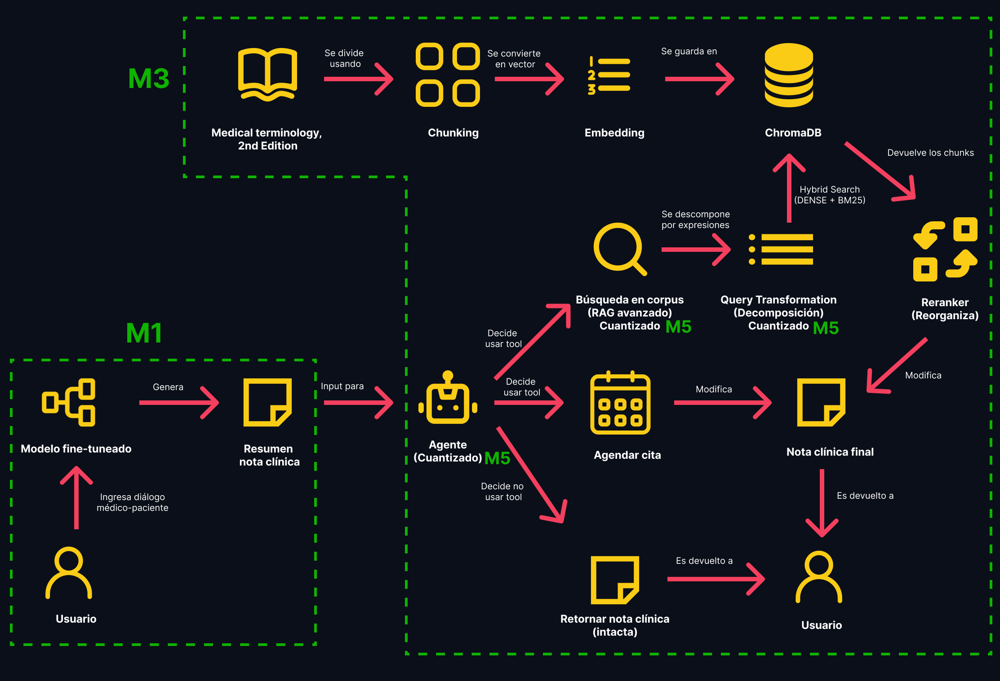

# El problema y el usuario
## ¿Quién es?
Médicos que deseen convertir transcripciones de diálogos médico-pacientes en resúmenes de historia clínica con terminología médica apropiada.

## ¿Qué decide con el sistema?
El usuario debe ingresar un diálogo médico-paciente, del cual recibe un resumen de historia clínica. A partir de esto, el usuario debe decidir si es una interpretación correcta según el contexto clínico del paciente y en qué sección de la historia clínica es la más apropiada para ingresar este resumen.

## ¿Qué métrica de éxito importa para esa decisión?
La métrica ideal en este contexto siempre será el juicio por un experto (médico). Sin embargo, la forma en la que más nos acercamos, y que está implementada en nuestro harness, es con un juez LLM que mida qué tan correcto es este resumen (en cuanto a no inventar datos que no están, que se tomen los datos que realmente son relevantes y que se use la terminología médica correcta).

# El sistema en un diagrama

# Decisiones técnicas
## Modelo base
Nuestra tarea es la transformación y resumen de texto, por lo que se espera que la familia de modelo que pueda servir es un encoder-decoder. De esta familia elegimos el modelo Flan-T5 (por encima de T5 o T5-small) porque este ya cuenta con una base de instruction-tuning. Adicionalmente, debía ser un modelo lo suficientemente pequeño para que pudiera ejecutarse en Colab gratuito, lo cual fue la limitante para no escoger modelos encoder-decoder más grandes que proporcionaran un resultado más robusto.

La alternativa que se pensó fue MedGemma-1.5-4B-it, pero se descartó porque el fine-tuning se demoraba demasiado y Colab se desconectaba.

El proceso completo de selección de este modelo se puede encontrar en [Proceso.md](../Entrega1/Proceso.md).

## Recuperación
El corpus del RAG es el libro "Medical Terminology, 2nd edition" (Open RN, licencia CC BY 4.0), dividido en 6086 chunks sin overlap. Para los embeddings elegimos BAAI/bge-small-en-v1.5 en lugar de paraphrase-multilingual-MiniLM-L12-v2, porque todo nuestro pipeline trabaja en inglés (no necesitamos un modelo multilingüe) y porque acepta 512 tokens en vez de 128, lo que permite representar chunks de párrafos extensos. Los embeddings se guardan en ChromaDB como base de datos vectorial. Como modelo generador del RAG usamos Qwen2.5-1.5B-Instruct.

Sobre el RAG ingenuo construimos un RAG avanzado con tres técnicas: descomposición de la consulta con un LLM para extraer cada expresión que debe traducirse a terminología médica (máximo 6 por nota), hybrid search que combina la búsqueda dense con BM25 mediante RRF, y un reranker que reordena los chunks recuperados (k=3 por término y score mínimo mayor a 0 para evitar reemplazos que no sean coherentes). El proceso completo de construcción del RAG se puede encontrar en [README_M3.md](../Entrega3/README_M3.md).

## Patrón visual
Para este proyecto no se implementaron modelos visuales, debido a que el problema implica la conversión de conversaciones entre médicos y pacientes a resúmenes de historia clínica. Este proceso solo involucra texto y no requiere el uso de imágenes para llevar a cabo el objetivo y la resolución del problema.

## Técnica de eficiencia
Para la cuantización se empleó como técnica el GGUF usando llama-cpp. La razón para elegir GGUF en lugar de otras herramientas de cuantización como bitsandbytes es porque GGUF nos permite cuantizar y usar el modelo tanto en CPU como en GPU, lo cual representa una ventaja frente a los otros métodos de cuantización porque no teníamos claro inicialmente el entorno en el cual sería desplegado nuestro pipeline. Otros métodos exigen GPU e, incluso, algunos exigen que sea de la marca NVIDIA, lo cual representa una restricción grande a la hora de poder desplegar el código y, más aún, si a esto le sumamos que sea de manera gratuita.

La decisión de realizar la cuantización con int8 o int4 se redujo a las pruebas realizadas con ambas cuantizaciones. Si bien pudimos comprobar (como lo vimos en clase) que la diferencia de latencia entre int8 e int4 no es tan significativa como la que hay entre el modelo sin cuantizar e int8, elegimos quedarnos con int4 por varias razones. Los resultados del harness no fueron tan diferentes entre ambas cuantizaciones, lo que indica que con int4 la pérdida de calidad no es tan significativa como lo podría ser en otros escenarios. Inicialmente probamos el sistema con int8, el cual funcionaba adecuadamente (evidenciado en el harness); sin embargo, pudimos apreciar que con esta cuantización el agente no llamaba nunca la tool del RAG, sin importar el tipo de input que se le pasara. Al intentar los mismos ejemplos con int4, el agente sí pudo reconocer que debía llamar la tool del RAG cuando era pertinente y por este motivo decidimos elegir esta cuantización en lugar de int8.

# Tabla evolutiva

Según la tabla evolutiva podemos ver la evolución del sistema evaluado con el mismo harness, y con cada modificación. Se midió desde el modelo con fine-tuning, modelo con RAG ingenuo, RAG avanzado, y finalmente el modelo cuantizado desplegado. Se puede observar lo siguiente:

- Métricas clásicas: Se tomaron las métricas Rouge y BERT. Se evidencia una mejora en las métricas al utilizar el RAG ingenuo, pero se evidencia una ligera baja de las métricas para el RAG avanzado. Como estas métricas se basan exclusivamente en similitud sintactica, y el RAG tiene como objetivo una paráfrasis semántica a términos médicos, es de esperar que no se parezca exactamente a la nota inicial, pero mantenga el significado. Como tal, aunque no permite concluirlo, se puede conjeturar que el "empeoramiento" de las métricas clasicas, indicando diferencia sintáctica, refleja realmente una paráfrasis  (sin poder determinar si fue buena o mala, solo que ya no se parecen tanto, lo cual es de esperar). 

- 

# Ablación

# Análisis de errores

# Limitaciones

# Ética
## ¿A quién podría fallarle más?
Sospechamos que el modelo no funciona tan bien en ciertos diálogos pertenecientes a partes puntuales de la historia clínica. Por ejemplo, cuando se describen antecedentes del paciente (por ejemplo antecedentes personales o alérgicos), el modelo suele confundirse y toma antecedentes negativos y los transforma en antecedentes positivos (es decir, cuando un paciente niega tener un antecedente, el modelo lo transforma y afirma que el paciente sí tiene ese antecedente).
Adicionalmente, el RAG se suele equivocar transformando terminología médica muy especializada o aquellas cuya forma coloquial de decirse requiera más de una palabra (no siempre pasa esto, pero algunas veces sí falla cuando debe reconocer que el término coloquial se compone por más de una palabra).

Estos fallos no se midieron objetivamente sino que fueron producto de la experimentación que tuvimos a la hora de ensayar el modelo con varios tipos de ejemplos.

FInalmente, es claro que nuestro modelo deja por fuera a cualquier médico cuya práctica no sea en inglés, ya que el modelo solo fue entrenado con diálogos en este idioma.

## ¿Qué pasa con los datos?
El sistema recibe datos de conversaciones médico-paciente. Es responsabilidad del usuario que ingresa estos diálogos garantizar la privacidad, tanto del paciente como del médico, anonimizando todo dato que pueda llevar a la identificación de los sujetos. Sin embargo, nuestro sistema usa modelos locales, por lo que esta información no se comparte con modelos de empresas como OpenAI o Anthropic. Nuestro sistema lo único que recolecta son logs de hora, latencia, componentes utilizados en la petición y si se usó la válvula; además, enviamos métricas del harness y rendimiento a Weights & Biases (que es un tercero), pero ninguno de estos datos contiene información de los datos clínicos proporcionados al sistema. Adicionalmente, no guardamos ningún dato en nuestro sistema: el sistema no cuenta con una base de datos para almacenar los inputs del usuario; la única base de datos es ChromaDB pero esta solo guarda el corpus del RAG. 

## ¿Qué daño haría un error?
El peor daño que se puede cometer es que la nota clínica generada tenga imprecisiones suficientemente graves que puedan impactar en el diagnóstico y/o tratamiento de los pacientes, lo que implica un daño directo sobre pacientes (en su salud) y sobre el médico (en términos legales y de ética médica). El sistema genera una alerta al crear un resumen clínico advirtiendo al usuario de que este es un sistema de IA y que esta debe ser revisada por un profesional de la salud para verificar la veracidad y tomar la decisión final.

# Quién hizo qué

# Uso de IA
